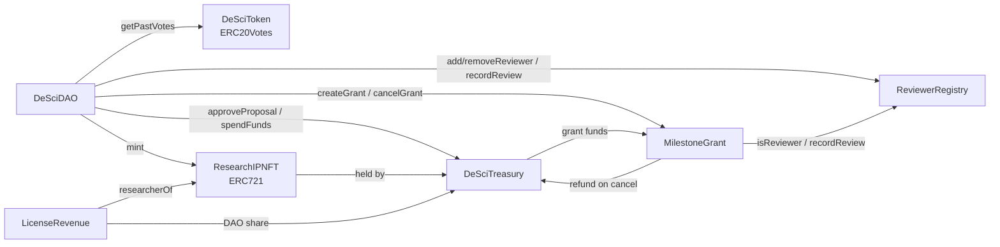
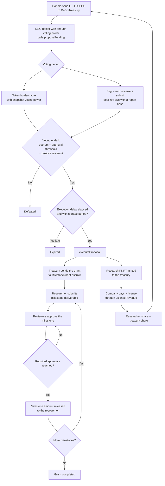
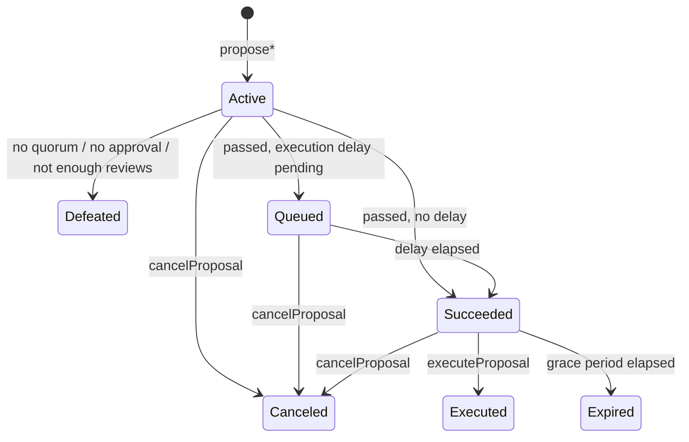

# DeSci DAO

## About

DeSci DAO is a decentralized science (DeSci) organization built on Ethereum. The community holds a governance token, votes to fund research projects, pays researchers by milestones once scientific reviewers approve their deliverables, and keeps the resulting intellectual property as an IP-NFT in the DAO treasury. License revenue from that IP is split between the researcher and the treasury, so it funds new research.

## Project Title

**DeSci DAO: Community-Governed Research Funding with Peer Review, Milestone Grants and Research IP-NFTs**

---

## Table of Contents

1. [Project Description](#project-description)
2. [How it Works](#how-it-works)
3. [Technical Docs](#technical-docs)
4. [Deployment](#deployment)
5. [Explain Test](#explain-test)
6. [Coverage Test](#coverage-test)
7. [Deploying to a Real Network](#deploying-to-a-real-network)

---

## Project Description

Traditional research funding is slow, centralized and opaque. Few institutions decide which projects get funded, researchers often lose the rights to their own results, and the public that pays for science rarely shares in its outcomes.

DeSci DAO moves this process on-chain:

- **Community funding.** Holders of the governance token **DSG** create and vote on proposals to fund research projects. Voting power is measured with snapshots (`ERC20Votes`), so the same tokens cannot vote twice by being transferred during a vote.
- **Scientific peer review.** A funding proposal is not executed just because it has votes. It also needs a minimum number of positive reviews from registered scientific reviewers, and more positive than negative reviews. Reviewers cannot review proposals where they are the proposer or the researcher (conflict of interest).
- **Milestone payments.** Approved funds do not go straight to the researcher. They are moved to an escrow contract (`MilestoneGrant`) and released one milestone at a time, in order, after reviewers approve each deliverable. The DAO can cancel a grant, and the unreleased funds go back to the treasury.
- **Research IP-NFTs.** Each funded project mints an ERC-721 token (`ResearchIPNFT`) held by the treasury. The token points, through a hash, to the off-chain legal agreement and research plan that define the IP rights.
- **License revenue.** Companies that license a research result pay through `LicenseRevenue`. A configurable share (up to 50%) goes to the researcher and the rest goes to the treasury.
- **Non-transferable reputation.** Every proposal review and milestone approval increases the reviewer's `reviewCount` in `ReviewerRegistry`. Reputation is not a token, so it cannot be bought or sold.

The DAO governance keeps the safety rules of a classic token DAO: configuration bounds, a treasury funds check when proposing, one active proposal per proposer, cancellation when the proposer drops below the threshold, a configurable approval threshold, an execution delay (timelock), a grace period and explicit proposal states.

**Tech stack:** Solidity `0.8.35`, Foundry (Forge), OpenZeppelin Contracts (`ERC20Votes`, `ERC721`, `Ownable`, `SafeERC20`).

---

## How it Works

### Smart Contracts

| Contract | Standard / Base | Role |
|---|---|---|
| [`DeSciToken`](src/DeSciToken.sol) | ERC-20 + `ERC20Votes` + `Ownable` | Governance token (DSG). Records voting power checkpoints on every balance change, uses a timestamp clock (ERC-6372) and supports native delegation. |
| [`DeSciDAO`](src/DeSciDAO.sol) | `Ownable` | Governance core. Creates proposals (Funding, CancelGrant, AddReviewer, RemoveReviewer), counts votes and peer reviews, and executes the approved proposals on the other contracts. |
| [`DeSciTreasury`](src/DeSciTreasury.sol) | `Ownable` + `IERC721Receiver` | Holds ETH and ERC-20 donations (e.g. USDC) and the Research IP-NFTs. Only the DAO can approve and spend funds. |
| [`MilestoneGrant`](src/MilestoneGrant.sol) | `Ownable` | Escrow that holds each grant and releases it to the researcher milestone by milestone after reviewer approvals. Refunds unreleased funds to the treasury on cancellation. |
| [`ReviewerRegistry`](src/ReviewerRegistry.sol) | `Ownable` | Registry of scientific reviewers and their non-transferable reputation. Owned by the DAO after setup, so reviewers are managed by governance. |
| [`ResearchIPNFT`](src/ResearchIPNFT.sol) | ERC-721 + `Ownable` | One IP-NFT per funded project, minted by the DAO to the treasury. Stores the proposal, researcher and legal agreement hash. |
| [`LicenseRevenue`](src/LicenseRevenue.sol) | `Ownable` | Collects license payments for an IP-NFT and splits them between the researcher and the treasury. |
| [`IDeSci`](src/interfaces/IDeSci.sol) | Interfaces | `IDeSciTreasury`, `IMilestoneGrant`, `IResearchIPNFT`, `IReviewerRegistry`: the functions the contracts call on each other. |

### Contract Architecture



### Research Funding Flow



### Proposal States



### Proposal Types

| Type | Created with | Effect on execution |
|---|---|---|
| `Funding` | `proposeFunding` | Treasury funds go to `MilestoneGrant`, a grant is created and an IP-NFT is minted to the treasury. Requires peer review. |
| `CancelGrant` | `proposeCancelGrant` | The active grant is canceled and its unreleased funds return to the treasury. |
| `AddReviewer` | `proposeReviewerChange(..., true)` | The address is registered in `ReviewerRegistry`. |
| `RemoveReviewer` | `proposeReviewerChange(..., false)` | The address is removed from `ReviewerRegistry` (its reputation is kept). |

---

## Technical Docs

### DeSciDAO

**Proposal creation** (caller needs at least `proposalThreshold` votes at the previous timestamp and no other active proposal)

| Function | Description |
|---|---|
| `proposeFunding(string description, address researcher, address token, uint256[] amounts, bytes32 documentHash) → uint256` | Proposes funding a research project paid in `amounts.length` milestones (1 to 10). Checks that every amount is greater than 0 and that the treasury holds the total in `token`. `documentHash` is the hash of the research plan / legal agreement. |
| `proposeCancelGrant(string description, uint256 grantId) → uint256` | Proposes canceling an active grant. |
| `proposeReviewerChange(string description, address reviewer, bool add) → uint256` | Proposes adding (`add = true`) or removing (`add = false`) a reviewer. |

**Voting and peer review**

| Function | Description |
|---|---|
| `vote(uint256 proposalId, bool support)` | Votes for or against with the voting power at the proposal snapshot (`getPastVotes`). One vote per address. |
| `reviewProposal(uint256 proposalId, bytes32 reportHash, bool recommend)` | Peer review of a Funding proposal during the voting period. Only registered reviewers who are neither the proposer nor the researcher. Increases the reviewer's reputation. |

**Execution and cancellation**

| Function | Description |
|---|---|
| `executeProposal(uint256 proposalId)` | Callable by anyone after the voting period if quorum, approval threshold and (for Funding) peer review requirements are met, the execution delay has elapsed and the grace period has not. Marks the proposal executed before external calls. |
| `cancelProposal(uint256 proposalId)` | Cancels a non-executed proposal. Allowed for the proposer, the owner, or anyone when the proposer's current votes are below `proposalThreshold`. |

**Views**

| Function | Description |
|---|---|
| `state(uint256 proposalId) → ProposalState` | Returns `Active`, `Canceled`, `Defeated`, `Queued`, `Succeeded`, `Expired` or `Executed`. |
| `getProposal(uint256 proposalId) → Proposal` | Returns all proposal data. |
| `getMilestones(uint256 proposalId) → uint256[]` | Returns the milestone amounts of a Funding proposal. |
| `getVoteInfo(uint256 proposalId, address voter) → (bool voted, bool support)` | Whether an address voted and how. |
| `grantOfProposal(uint256)` / `ipTokenOfProposal(uint256)` | Grant ID and IP-NFT ID created by an executed Funding proposal. |

**Configuration (only owner)**

| Function | Bounds |
|---|---|
| `updateConfiguration(uint256 proposalThreshold, uint256 votingPeriod, uint256 quorumVotes)` | threshold > 0, 1 day ≤ voting period ≤ 30 days, quorum > 0 |
| `updateExecutionRules(uint256 approvalThresholdBps, uint256 executionDelay, uint256 gracePeriod)` | 5000 ≤ approval ≤ 9000 bps, delay ≤ 30 days, 1 day ≤ grace ≤ 90 days (default: 5000 bps, 0, 14 days) |
| `setMinReviews(uint256 minReviews)` | 1 to 5 (default: 1) |

**Pass rules**

- Quorum: `forVotes + againstVotes >= quorumVotes`
- Approval: `forVotes * 10000 > (forVotes + againstVotes) * approvalThresholdBps`
- Peer review (Funding only): `positiveReviews >= minReviews` and `positiveReviews > negativeReviews`

### DeSciToken

| Function | Description |
|---|---|
| `constructor(string name, string symbol, uint256 initialSupply)` | Mints the initial supply to the deployer. |
| `delegate(address delegatee)` | Activates voting power (to oneself or another address). Tokens give no votes until delegated. |
| `getVotes(address)` / `getVotingPower(address)` | Current voting power. |
| `getPastVotes(address, uint256 timepoint)` | Voting power at a past timestamp, used by the DAO snapshots. |
| `clock()` / `CLOCK_MODE()` | Timestamp clock (`mode=timestamp`). |
| `mint(address to, uint256 amount)` | Mints new tokens (only owner). |
| `burn(uint256 amount)` | Burns the caller's tokens. |

### DeSciTreasury

| Function | Description |
|---|---|
| `setDAO(address dao)` | Sets the DAO allowed to spend (only owner). |
| `approveProposal(uint256 proposalId)` | Marks a proposal as approved (only DAO, once). |
| `spendFunds(uint256 proposalId, address recipient, uint256 amount, address token)` | Sends ETH (`token = address(0)`) or ERC-20 for an approved proposal (only DAO, once per proposal). |
| `donate()` / `receive()` | ETH donations. |
| `donateToken(address token, uint256 amount)` | ERC-20 donation (requires a prior `approve`). |
| `getBalance(address token)` | ETH or token balance. |
| `isProposalApproved(uint256)` / `isProposalExecuted(uint256)` | Spending status of a proposal. |
| `emergencyWithdraw(address token, uint256 amount, address recipient)` | Emergency withdrawal (only owner). |
| `onERC721Received(...)` | Accepts IP-NFTs sent with `safeTransferFrom` / `_safeMint`. |

### MilestoneGrant

| Function | Description |
|---|---|
| `setDAO(address dao)` | Sets the DAO allowed to create and cancel grants (only owner). |
| `setRequiredApprovals(uint256 n)` | Reviewer approvals needed per milestone, 1 to 5 (only owner, default 1). |
| `createGrant(uint256 proposalId, address researcher, address token, uint256[] amounts, bytes32 researchPlanHash) → uint256` | Creates a grant (only DAO). The funds must already be in the contract; they are tracked in `lockedFunds[token]`. |
| `submitMilestone(uint256 grantId, bytes32 deliverableHash)` | The researcher submits the deliverable of the current milestone. |
| `approveMilestone(uint256 grantId)` | A registered reviewer (not the researcher) approves the submitted milestone. When `requiredApprovals` is reached, the milestone amount is paid to the researcher. |
| `cancelGrant(uint256 grantId)` | Cancels an unfinished grant and refunds the unreleased amount to the treasury (only DAO). |
| `isGrantActive(uint256)` / `getGrant(uint256)` / `getMilestone(uint256, uint256)` | Views. |

### ReviewerRegistry

| Function | Description |
|---|---|
| `addReviewer(address)` / `removeReviewer(address)` | Registers or removes a reviewer (only owner, the DAO after setup). Reputation is kept on removal. |
| `setRecorder(address recorder, bool allowed)` | Allows contracts (DAO, MilestoneGrant) to record reviews (only owner). |
| `recordReview(address reviewer)` | Increases `reviewCount` of a reviewer (only recorders). |
| `isReviewer(address)` / `reviewCount(address)` / `reviewerCount()` | Views. |

### ResearchIPNFT

| Function | Description |
|---|---|
| `setMinter(address)` | Sets the contract allowed to mint, i.e. the DAO (only owner). |
| `setBaseURI(string)` | Sets the metadata base URI (only owner). |
| `mint(address to, uint256 proposalId, address researcher, bytes32 agreementHash) → uint256` | Mints an IP-NFT with its research data (only minter). |
| `getResearchIP(uint256)` / `researcherOf(uint256)` | Research IP data and researcher of a token. |

### LicenseRevenue

| Function | Description |
|---|---|
| `constructor(address researchIPNFT, address treasury, uint256 researcherShareBps)` | Researcher share up to 5000 bps (50%). |
| `payLicense(uint256 tokenId, address token, uint256 amount)` | Pays a license: `amount * researcherShareBps / 10000` goes to the researcher and the rest to the treasury. Requires a prior `approve`. |
| `setResearcherShare(uint256)` | Updates the researcher share (only owner). |
| `totalRevenue(uint256 tokenId, address token)` | Accumulated license revenue. |

### Events

| Contract | Events |
|---|---|
| DeSciDAO | `ProposalCreated`, `FundingProposed`, `Voted`, `ProposalReviewed`, `ProposalExecuted`, `ResearchFunded`, `ProposalCanceled`, `ConfigurationUpdated`, `ExecutionRulesUpdated`, `MinReviewsUpdated` |
| DeSciTreasury | `ProposalApproved`, `FundsSpent`, `DonationReceived`, `DAOSet`, `EmergencyWithdrawal` |
| MilestoneGrant | `DAOSet`, `RequiredApprovalsUpdated`, `GrantCreated`, `MilestoneSubmitted`, `MilestoneApproved`, `MilestoneReleased`, `GrantCanceled` |
| ReviewerRegistry | `ReviewerAdded`, `ReviewerRemoved`, `RecorderUpdated`, `ReviewRecorded` |
| ResearchIPNFT | `MinterUpdated`, `BaseURIUpdated`, `ResearchIPMinted` |
| LicenseRevenue | `LicensePaid`, `ResearcherShareUpdated` |

---

## Deployment

The contracts are deployed and wired on the local Foundry EVM by the shared test setup ([`test/DeSciBase.t.sol`](test/DeSciBase.t.sol)), with `MockUSDC` (6 decimals) as the payment stablecoin. The same order applies to any network.

### Deployment order and constructor parameters

| # | Contract | Constructor arguments (values used in the tests) |
|---|---|---|
| 1 | `DeSciToken` | `"DeSci Governance Token"`, `"DSG"`, `1,000,000 DSG` |
| 2 | `DeSciTreasury` | `address(0)` (the DAO is set later) |
| 3 | `ReviewerRegistry` | none |
| 4 | `MilestoneGrant` | treasury, registry |
| 5 | `ResearchIPNFT` | `"DeSci Research IP"`, `"DSIP"` |
| 6 | `DeSciDAO` | token, treasury, grants, IP-NFT, registry, `proposalThreshold = 1,000 DSG`, `votingPeriod = 10 days`, `quorumVotes = 10,000 DSG` |
| 7 | `LicenseRevenue` | IP-NFT, treasury, `researcherShareBps = 2000` (20%) |

### Post-deployment wiring

```solidity
treasury.setDAO(address(dao));
grants.setDAO(address(dao));
ipnft.setMinter(address(dao));
registry.setRecorder(address(dao), true);
registry.setRecorder(address(grants), true);
registry.addReviewer(reviewer1);               // initial reviewers
registry.addReviewer(reviewer2);
registry.transferOwnership(address(dao));      // reviewers managed by governance from now on
```

After wiring, token holders must call `delegate` to activate their voting power, and the treasury must be funded (ETH or ERC-20) before funding proposals can be created.

### Deployed addresses

| Contract | Network | Address |
|---|---|---|
| DeSciToken | — | Not deployed to a public network yet |
| DeSciTreasury | — | Not deployed to a public network yet |
| ReviewerRegistry | — | Not deployed to a public network yet |
| MilestoneGrant | — | Not deployed to a public network yet |
| ResearchIPNFT | — | Not deployed to a public network yet |
| DeSciDAO | — | Not deployed to a public network yet |
| LicenseRevenue | — | Not deployed to a public network yet |

### Build configuration

Defined in [`foundry.toml`](foundry.toml): Solidity `0.8.35`, optimizer enabled with 200 runs (keeps `DeSciDAO` below the 24,576-byte EIP-170 limit), compiler warnings from `lib/` ignored, and the `block-timestamp` lint excluded because governance periods are measured in days.

### Commands

```shell
# Install dependencies (git submodules)
git submodule update --init --recursive

# Build and show contract sizes
forge build --sizes

# Run the tests
forge test -vvv

# Coverage
forge coverage --report summary

# Format check
forge fmt --check
```

The GitHub Actions workflow ([`.github/workflows/test.yml`](.github/workflows/test.yml)) runs `forge fmt --check`, `forge build --sizes` and `forge test -vvv` on every push and pull request.

---

## Explain Test

**97 tests in 8 suites, all passing.** Every suite inherits [`DeSciBase`](test/DeSciBase.t.sol), which deploys and wires all contracts, gives `alice` 50K DSG and `bob` 30K DSG, registers two reviewers, funds the treasury with 100K mock USDC and uses a standard grant of 60K USDC in three milestones (10K, 20K, 30K). [`test/mocks/Mocks.sol`](test/mocks/Mocks.sol) provides `MockUSDC`, `RejectETH` (rejects ETH) and `FalseToken` (transfers return `false`).

### DeSciIntegration.t.sol (1 test)

| Test | What it checks |
|---|---|
| `testFullResearchLifecycle` | End to end: a donation, a funding proposal, two peer reviews, votes, execution, three milestones submitted and approved, the IP-NFT held by the treasury, a license payment split 20/80, and the reviewers' reputation. |

### DeSciDAO.t.sol (46 tests)

| Test | What it checks |
|---|---|
| `testConstructorSetsConfiguration` | The constructor stores the connected contracts and the configuration. |
| `testConstructorRevertsZeroAddresses` | The constructor reverts with any zero contract address. |
| `testConstructorRevertsInvalidConfiguration` | The constructor reverts with an invalid threshold, voting period or quorum. |
| `testProposeFunding` | A funding proposal stores all its data and milestones. |
| `testProposeFundingRevertsInvalidParameters` | Reverts with a zero researcher, token or document hash. |
| `testProposeFundingRevertsInvalidMilestoneCount` | Reverts with 0 or more than 10 milestones. |
| `testProposeFundingRevertsZeroMilestone` | Reverts when a milestone amount is 0. |
| `testProposeFundingRevertsInsufficientTreasuryFunds` | Reverts when the treasury cannot cover the grant. |
| `testProposeRevertsInsufficientVotingPower` | Reverts without enough voting power at the snapshot. |
| `testProposeRevertsEmptyDescription` | Reverts with an empty description. |
| `testProposeRevertsWhileActive` | A proposer cannot create a second proposal while one is active. |
| `testProposeAllowedAfterVotingEnds` | A proposer can create a new proposal once voting ends. |
| `testProposeCancelGrant` | Proposing to cancel an active grant. |
| `testProposeCancelGrantRevertsInactiveGrant` | Proposing to cancel an inactive grant reverts. |
| `testProposeReviewerChange` | Proposing to add and remove reviewers. |
| `testProposeReviewerChangeRevertsInvalid` | Reverts with a zero address, an existing reviewer (add) or a non-reviewer (remove). |
| `testVoteForAndAgainst` | Votes for and against are counted with the right weight. |
| `testVoteReverts` | Reverts for a nonexistent proposal, after voting ends, on double voting and without voting power. |
| `testVoteRevertsCanceled` | Voting on a canceled proposal reverts. |
| `testDoubleVoteWithTransferIsBlocked` | Tokens transferred after the snapshot cannot vote again. |
| `testReviewProposal` | Positive and negative reviews are counted and recorded as reputation. |
| `testReviewRevertsProposalType` | Reverts for nonexistent and non-funding proposals. |
| `testReviewRevertsTiming` | Reverts after voting ends or when the proposal is canceled. |
| `testReviewRevertsReviewer` | Reverts for non-reviewers and for conflicts of interest (proposer or researcher). |
| `testReviewRevertsDuplicateAndEmptyReport` | Reverts when reviewing twice or with an empty report hash. |
| `testExecuteFunding` | Execution moves the funds to the escrow, creates the grant and mints the IP-NFT. |
| `testExecuteCancelGrant` | Executing a cancel grant proposal refunds the treasury. |
| `testExecuteReviewerChanges` | Executing reviewer proposals adds and removes reviewers. |
| `testExecuteRevertsLifecycle` | Reverts before voting ends, when executed twice and when canceled. |
| `testExecuteRevertsVotes` | Reverts without quorum or without approval. |
| `testExecuteRevertsInsufficientReviews` | Funding proposals revert without enough positive reviews. |
| `testExecuteRevertsReviewTie` | A tie between positive and negative reviews defeats the proposal. |
| `testExecuteRevertsExecutionWindow` | Execution respects the execution delay and the grace period. |
| `testCancelByProposerAndOwner` | The proposer and the owner can cancel. |
| `testCancelWhenProposerBelowThreshold` | Anyone can cancel when the proposer drops below the threshold. |
| `testCancelReverts` | Reverts for nonexistent, executed or already canceled proposals and unauthorized callers. |
| `testViewsRevertProposalDoesNotExist` | `state` and `getProposal` revert for nonexistent proposals. |
| `testStateSucceeded` | State is `Succeeded` when the proposal can be executed. |
| `testStateDefeatedWithoutQuorum` | State is `Defeated` without quorum. |
| `testUpdateConfiguration` | The owner updates threshold, voting period and quorum. |
| `testUpdateConfigurationReverts` | Reverts for non-owners and invalid values. |
| `testUpdateExecutionRules` | The owner updates approval threshold, delay and grace period. |
| `testUpdateExecutionRulesReverts` | Reverts with values out of bounds. |
| `testHigherApprovalThreshold` | A higher approval threshold defeats a simple majority. |
| `testSetMinReviews` | The owner updates the minimum positive reviews. |
| `testSetMinReviewsReverts` | Reverts for non-owners and values out of bounds. |

### MilestoneGrant.t.sol (16 tests)

| Test | What it checks |
|---|---|
| `testConstructorAndDefaults` | Constructor values and default `requiredApprovals = 1`. |
| `testConstructorRevertsZeroAddresses` | Reverts with a zero treasury or registry. |
| `testSetDAOReverts` | `setDAO` reverts for non-owners and the zero address. |
| `testSetRequiredApprovals` | The owner updates required approvals within bounds. |
| `testCreateGrant` | Creating a grant locks the funds and stores its data. |
| `testCreateGrantRevertsInvalid` | Reverts when not called by the DAO or with invalid data. |
| `testCreateGrantRevertsNotFunded` | Reverts when the funds are not in the contract. |
| `testMilestonesReleasedInOrder` | Every milestone is paid in order until the grant is completed. |
| `testMilestoneNeedsRequiredApprovals` | A milestone is paid only after the required number of approvals. |
| `testSubmitMilestoneReverts` | Reverts for a missing grant, a non-researcher, an empty hash, a double submission or a completed grant. |
| `testSubmitMilestoneRevertsCanceled` | Submitting on a canceled grant reverts. |
| `testApproveMilestoneReverts` | Reverts for a missing grant, non-reviewers, the researcher, unsubmitted milestones, double approvals or a completed grant. |
| `testApproveMilestoneRevertsCanceled` | Approving on a canceled grant reverts. |
| `testCancelGrantRefundsUnreleased` | Canceling refunds only the unreleased funds to the treasury. |
| `testCancelGrantReverts` | Reverts for non-DAO callers, missing, canceled or completed grants. |
| `testViewsRevertMissing` | `getGrant` and `getMilestone` revert for missing data. |

### DeSciTreasury.t.sol (10 tests)

| Test | What it checks |
|---|---|
| `testSetDAO` | `setDAO` updates the DAO and reverts for non-owners or the zero address. |
| `testApproveProposal` | Approval by the DAO, and reverts for other callers or double approval. |
| `testSpendFundsTokenAndETH` | The DAO spends ERC-20 tokens and ETH. |
| `testSpendFundsRevertsChecks` | Reverts on access, approval, double spending and parameter checks. |
| `testSpendFundsRevertsTransfers` | Reverts on insufficient balances and failed ETH / token transfers. |
| `testDonations` | ETH donations (`donate` and `receive`) and token donations. |
| `testDonationsRevert` | Donations revert with zero values, a zero token or a token whose transfer fails. |
| `testReceivesIPNFT` | The treasury accepts IP-NFTs through safe transfers. |
| `testEmergencyWithdraw` | The owner withdraws tokens and ETH. |
| `testEmergencyWithdrawReverts` | Reverts for non-owners and invalid values. |

### LicenseRevenue.t.sol (7 tests)

| Test | What it checks |
|---|---|
| `testConstructor` | Constructor configuration. |
| `testConstructorReverts` | Reverts with a zero IP-NFT or treasury, or a share above 50%. |
| `testPayLicenseSplitsRevenue` | A payment is split 20% researcher / 80% treasury and recorded in `totalRevenue`. |
| `testPayLicenseZeroResearcherShare` | With a 0% share everything goes to the treasury. |
| `testPayLicenseReverts` | Reverts with a zero token, a zero amount or a nonexistent IP-NFT. |
| `testPayLicenseRevertsTransferFailed` | Reverts through `SafeERC20` when the token transfer returns `false`. |
| `testSetResearcherShare` | The owner updates the share within bounds; non-owners revert. |

### DeSciToken.t.sol (7 tests)

| Test | What it checks |
|---|---|
| `testMetadataAndDistribution` | Name, symbol, total supply and initial distribution. |
| `testDelegate` | Delegation moves voting power without moving tokens. |
| `testVotesInactiveWithoutDelegation` | Tokens give no voting power until delegated. |
| `testGetPastVotes` | Voting power history is kept and future lookups revert. |
| `testClock` | The clock uses timestamps (`mode=timestamp`). |
| `testMintAndBurn` | Mint and burn update balances and votes. |
| `testMintRevertsNotOwner` | Minting reverts for non-owners. |

### ResearchIPNFT.t.sol (5 tests)

| Test | What it checks |
|---|---|
| `testMint` | Minting stores the proposal, researcher, agreement hash and timestamp, and the treasury owns the token. |
| `testMintReverts` | Reverts for non-minters, a zero researcher or an empty agreement hash. |
| `testViewsRevertNonexistentToken` | Views revert for nonexistent tokens. |
| `testOwnerSettings` | The owner sets the minter and the base URI (`tokenURI`). |
| `testOwnerSettingsRevertNotOwner` | Owner settings revert for non-owners. |

### ReviewerRegistry.t.sol (5 tests)

| Test | What it checks |
|---|---|
| `testSetup` | Reviewers and recorders are registered and ownership belongs to the DAO. |
| `testAddAndRemoveReviewer` | Adding and removing a reviewer keeps their reputation. |
| `testReviewerManagementReverts` | Reverts for non-owners, the zero address, duplicate reviewers and non-reviewers. |
| `testSetRecorder` | The owner allows and disallows recorders; the zero address reverts. |
| `testRecordReviewReverts` | Reverts for non-recorders and non-reviewers. |

---

## Coverage Test

```shell
forge coverage --report summary
```


All production contracts in `src/` reach **100% line, statement, branch and function coverage**. The only uncovered lines belong to the test helper `test/mocks/Mocks.sol`.

| File | % Lines | % Statements | % Branches | % Funcs |
|---|---|---|---|---|
| src/DeSciDAO.sol | 100.00% (180/180) | 100.00% (179/179) | 100.00% (126/126) | 100.00% (21/21) |
| src/DeSciToken.sol | 100.00% (14/14) | 100.00% (8/8) | 100.00% (0/0) | 100.00% (7/7) |
| src/DeSciTreasury.sol | 100.00% (52/52) | 100.00% (41/41) | 100.00% (35/35) | 100.00% (13/13) |
| src/LicenseRevenue.sol | 100.00% (22/22) | 100.00% (22/22) | 100.00% (13/13) | 100.00% (3/3) |
| src/MilestoneGrant.sol | 100.00% (90/90) | 100.00% (88/88) | 100.00% (59/59) | 100.00% (10/10) |
| src/ResearchIPNFT.sol | 100.00% (23/23) | 100.00% (17/17) | 100.00% (8/8) | 100.00% (6/6) |
| src/ReviewerRegistry.sol | 100.00% (20/20) | 100.00% (16/16) | 100.00% (12/12) | 100.00% (4/4) |
| **Total** | **99.57% (460/462)** | **99.76% (420/421)** | **100.00% (253/253)** | **98.68% (75/76)** |

---

## Deploying to a Real Network

The project has only been deployed on the local Foundry EVM. Before a deployment on a public network (testnet or mainnet), take the following items into account.

### Replace the owner with a Safe multisig

Every contract uses `Ownable`, and the deployer account receives significant powers:

- `DeSciDAO`: cancel any proposal, change quorum, voting period, threshold, approval threshold, execution delay, grace period and minimum reviews.
- `DeSciTreasury`: `emergencyWithdraw` of all funds and `setDAO`.
- `MilestoneGrant`: `setDAO` and `setRequiredApprovals`.
- `ResearchIPNFT`: `setMinter` and `setBaseURI`.
- `DeSciToken`: unlimited `mint`, which changes voting power.
- `LicenseRevenue`: `setResearcherShare`.

A single private key (EOA) holding these powers is a single point of failure. After wiring, transfer the ownership of every contract (except `ReviewerRegistry`, which is already owned by the DAO) to a **[Safe](https://safe.global) multisig** with several independent signers and a threshold (for example 3-of-5):

```solidity
dao.transferOwnership(safe);
treasury.transferOwnership(safe);
grants.transferOwnership(safe);
ipnft.transferOwnership(safe);
token.transferOwnership(safe);
license.transferOwnership(safe);
```

### Research IP-NFTs need a signed legal agreement

A `ResearchIPNFT` token **only has legal value if the signed agreement it points to exists**. The token stores `agreementHash`, a hash of an off-chain document, but the token by itself does not grant any intellectual property rights: the rights come from the legal agreement signed by the researcher (or their institution) and the DAO's legal entity. Before executing a Funding proposal:

- The legal agreement that assigns or licenses the IP must be signed by all parties.
- The `documentHash` of the proposal must be the hash of that signed document, stored in a durable location (e.g. IPFS with pinning).
- The DAO needs a legal wrapper (for example a foundation or an LLC) able to sign agreements and hold IP rights on behalf of the community.

### Other items to check before deploying

- **Security audit.** Have the contracts reviewed by an independent auditor before holding real funds.
- **Testnet first.** Deploy and run the full lifecycle on a testnet (e.g. Sepolia) before mainnet.
- **Real payment token.** Use the official address of the stablecoin on the target network (e.g. USDC) instead of `MockUSDC`.
- **Governance parameters.** Set `proposalThreshold` and `quorumVotes` according to the real token distribution, and use a non-zero `executionDelay` (it is 0 by default) so the community can react before a proposal is executed.
- **Initial reviewers.** Register real, identified reviewers before transferring the `ReviewerRegistry` ownership to the DAO, and set `minReviews` and `requiredApprovals` according to the number of reviewers.
- **Token distribution and delegation.** Distribute DSG before the first proposals and make sure holders call `delegate`, otherwise quorum cannot be reached.
- **Wiring checks.** Verify that `treasury.dao()`, `grants.dao()`, `ipnft.minter()`, the registry recorders and `registry.owner()` point to the right contracts.
- **Source verification.** Verify all contracts on the block explorer (e.g. with `forge verify-contract`) so anyone can read the deployed code.
- **Deployer key.** Use a hardware wallet or a secure key management solution for the deployment account, never a private key stored in plain text.
- **IP-NFT metadata.** Set a permanent `baseURI` (e.g. IPFS) for the IP-NFT metadata.

---

## License

MIT
